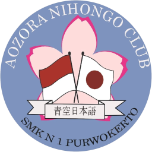

<div align="center">
  
  <h1>🌸 Aozora Web - Aozora Nihongo Club SMKN 1 Purwokerto</h1>
  <p><strong>Aplikasi Profil Komunitas, Portal Informasi Kegiatan &amp; Sistem Manajemen Ekstrakurikuler Bahasa dan Budaya Jepang</strong></p>

  <p>
    <a href="https://aozora.synchrolabs.site/" target="_blank">
      
    </a>
    
    
    
    
    
  </p>

  <p>🔗 <strong>URL Website Resmi (Live Production):</strong> <a href="https://aozora.synchrolabs.site/" target="_blank"><strong>https://aozora.synchrolabs.site/</strong></a></p>
</div>

---

## 📌 Tentang Proyek

**Aozora Web** adalah platform web terpadu yang dirancang untuk mendukung operasional dan keterbukaan informasi **Aozora Nihongo Club (ANC)**, ekstrakurikuler Bahasa dan Budaya Jepang di **SMK Negeri 1 Purwokerto**.

Aplikasi ini dapat diakses secara langsung melalui: **[https://aozora.synchrolabs.site/](https://aozora.synchrolabs.site/)**

Aplikasi ini menggabungkan dua ekosistem utama:
1. **Portal Publik**: Menampilkan profil klub, etalase divisi minat (Kaiwa, Shodo, Cosplay, Matsuri, Anime/Manga, Edukasi), videotron agenda kegiatan interaktif, dokumentasi foto/video resolusi tinggi dengan pop-up lightbox HD, musik latar tradisional Jepang, serta chatbot asisten virtual berbasis AI (**Sora-chan**).
2. **Panel Administrasi (Filament v5)**: Manajemen backoffice komprehensif berbasis peran (*Role-Based Access Control*) untuk mengelola event, rundown acara, arsip media, kepengurusan, serta pelacakan sirkulasi peminjaman inventaris perlengkapan klub.

---

## ✨ Fitur-Fitur Utama

### 🌐 1. Portal Publik &amp; Pengalaman Pengguna
- **Hero &amp; Landing Interaktif**: Sambutan interaktif bernuansa Jepang modern, audio koto tradisional yang dapat diaktifkan, dan animasi kelopak sakura (*sakura petals physics*).
- **Videotron &amp; Carousel Event Unggulan**: Slider kartu kegiatan dengan gesture geser mouse/layar sentuh, badge status, dan posisi kartu yang seragam serta proporsional.
- **Detail Event &amp; Galeri Multimedia HD**: 
  - Informasi lengkap kegiatan, jadwal rundown, lokasi GPS (Leaflet Map), dan kontak bantuan panitia.
  - Galeri arsip dokumentasi foto &amp; video dengan pop-up **Lightbox Modal HD**, swipe gesture di smartphone, navigasi keyboard panah, serta tombol unduh file asli.
  - Opsi unduh seluruh foto sekaligus via arsip `.ZIP` atau integrasi Google Drive.
- **Direktori Struktur Kepengurusan**: Profil pembina, pengurus harian, koordinator divisi, dan anggota aktif per periode.
- **Chatbot Asisten Pintar "Sora-chan"**: Asisten interaktif yang siap menjawab pertanyaan seputar materi dasar bahasa Jepang, jadwal perkumpulan, dan kegiatan ekstrakurikuler via streaming response.
- **Autentikasi Fleksibel**: Pendaftaran dan masuk akun lokal maupun integrasi akun Google melalui Google OAuth (Socialite).

### ⚙️ 2. Panel Administrasi (Backoffice Filament v5)
- **Manajemen Event &amp; Kegiatan**: Tambah/edit agenda, tandai event unggulan untuk beranda, atur tanggal, lokasi koordinat peta, dan rundown kegiatan.
- **Manajemen Media &amp; Dokumentasi**: Upload foto dokumentasi beresolusi tinggi, kompresi otomatis thumbnail, upload video, dan pengaturan tautan Google Drive / Aftermovie YouTube.
- **Sistem Inventaris &amp; Sirkulasi Peminjaman**:
  - Pendataan perlengkapan dan aset milik klub beserta foto dan status kondisi.
  - Pencatatan transaksi peminjaman barang oleh anggota dan pengembalian barang secara real-time.
- **Role-Based Access Control (RBAC)**: Pengaturan hak akses granular menggunakan Spatie Laravel Permission (Super Admin, Admin, Koordinator Event, Koordinator Inventaris, Tim PDD, dll).

---

## 🛠️ Tech Stack &amp; Dependencies

- **Framework**: [Laravel 13](https://laravel.com/)
- **Bahasa Pemrograman**: PHP 8.3+
- **Admin Panel**: [Filament v5](https://filamentphp.com/)
- **Frontend / Styling**: Blade Templates, Tailwind CSS v4, Livewire 3, Alpine.js
- **Database**: MariaDB / MySQL
- **Peta Interaktif**: Leaflet.js &amp; OpenStreetMap
- **Autentikasi &amp; Izin**: Laravel Fortify / Breeze &amp; Spatie Laravel Permission

---

## 💻 Prasyarat Sistem

Sebelum memasang aplikasi di lingkungan lokal, pastikan telah terinstal:
- **PHP** &gt;= 8.3 (dengan ekstensi: `pdo_mysql`, `mbstring`, `openssl`, `tokenizer`, `xml`, `ctype`, `json`, `bcmath`, `curl`, `intl`, `gd` / `imagick`)
- **Composer** (versi 2.x)
- **Node.js** (versi 18.x atau 20.x+) &amp; **NPM**
- **MySQL** atau **MariaDB** (bisa menggunakan XAMPP, Laragon, Docker, atau instalasi native)

---

## 🚀 Panduan Instalasi &amp; Menjalankan di Komputer Lokal

Ikuti langkah-langkah berikut untuk menjalankan proyek di komputer lokal:

### 1. Clone Repository
```bash
git clone https://github.com/FahriX3/aozora-web.git
cd aozora-web
```

### 2. Install Dependensi PHP
```bash
composer install
```

### 3. Install Dependensi Frontend
```bash
npm install
```

### 4. Konfigurasi Environment (`.env`)
Salin file `.env.example` menjadi `.env`:
```bash
cp .env.example .env
```
Lalu buat Application Encryption Key:
```bash
php artisan key:generate
```

Buka file `.env` dan sesuaikan koneksi database lokal kamu (contoh jika menggunakan XAMPP/Laragon):
```env
DB_CONNECTION=mysql
DB_HOST=127.0.0.1
DB_PORT=3306
DB_DATABASE=aozora_db
DB_USERNAME=root
DB_PASSWORD=
```

### 5. Setup Database (Pilih Salah Satu Cara)

#### Opsi A: Import Database Backup Lengkap (Sangat Disarankan ⭐)
File dump database terbaru sudah tersedia di dalam folder `database/backup_aozora_db.sql`.
1. Buat database baru di MySQL bernama `aozora_db`.
2. Import file SQL:
   - **Lewat Terminal:**
     ```bash
     mysql -u root -p aozora_db < database/backup_aozora_db.sql
     ```
   - **Atau lewat phpMyAdmin:** Buka `http://localhost/phpmyadmin` -&gt; Buat database `aozora_db` -&gt; Pilih tab **Import** -&gt; Pilih file `database/backup_aozora_db.sql` -&gt; Klik **Go**.

#### Opsi B: Menggunakan Migration &amp; Seeder Fresh
```bash
php artisan migrate:fresh --seed
```

### 6. Buat Symlink Storage (Penting untuk Gambar &amp; Foto)
```bash
php artisan storage:link
```

### 7. Kompilasi Aset Frontend
Untuk mode pengembangan:
```bash
npm run dev
```
Atau untuk build produksi:
```bash
npm run build
```

### 8. Jalankan Server Lokal
```bash
php artisan serve
```
Buka browser dan akses aplikasi di: **`http://localhost:8000`**

---

## 🔐 Akses Panel Admin (Filament)

- **Akses Lokal:** `http://localhost:8000/admin`
- **Akses Live Server:** `https://aozora.synchrolabs.site/admin`

| Peran (Role) | Email Login | Kata Sandi |
| :--- | :--- | :--- |
| **Super Admin** | `admin@aozora.local` | `password` |
| **Koordinator Kegiatan** | `event@aozora.local` | `password` |
| **Koordinator Inventaris**| `inventaris@aozora.local`| `password` |

---

## 📂 Struktur Direktori Proyek

```text
aozora-web/
├── app/
│   ├── Filament/          # Konfigurasi Resources & Widgets Panel Admin Filament
│   ├── Http/Controllers/  # Controller Halaman Publik, Event, dan Chatbot AI
│   ├── Models/            # Model Eloquent (Event, Documentation, Member, Loan, dll)
│   └── Providers/         # Service Providers & Filament Panel Providers
├── config/                # Berkas konfigurasi aplikasi
├── database/
│   ├── backup_aozora_db.sql # 💾 File backup database SQL siap import
│   ├── migrations/        # Berkas migrasi skema tabel database
│   └── seeders/           # Seeder data awal aplikasi
├── public/                # Web root publik (index.php, aset gambar, audio, dsb)
├── resources/
│   ├── css/               # Tailwind CSS stylesheets
│   ├── js/                # Script JavaScript frontend
│   └── views/             # Template tampilan Blade (Beranda, Event, Pengurus, dsb)
├── routes/                # Rute web.php & console.php
├── storage/               # Berkas upload media, cache, dan logs
└── tests/                 # Unit & Feature automated tests
```

---

## 👥 Anggota Tim Pengembang

Proyek ini disusun dan dikembangkan oleh:

| No | Nama Lengkap | No. Presensi |
| :---: | :--- | :---: |
| 1 | **Fahri Azzam Mandriva** | 14 |
| 2 | **Galang Ma'ruf Sherinian** | 17 |
| 3 | **Muhammad Iqbal Widodo** | 23 |

**SMK Negeri 1 Purwokerto**

---

## 📜 Lisensi &amp; Hak Cipta

Proyek ini dikembangkan untuk keperluan akademik dan manajemen ekstrakurikuler **Aozora Nihongo Club - SMK Negeri 1 Purwokerto**.
Dilindungi di bawah lisensi [MIT License](LICENSE).
